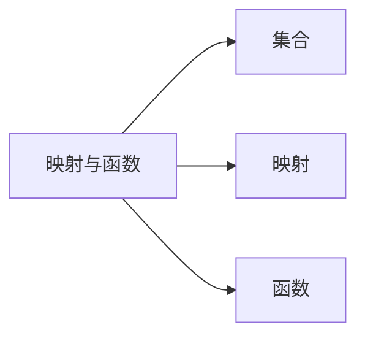

## Sec 1. 映射与函数

### Subsec 1.1 映射

#### 1.1.1 映射概念

!!! note "定义 1"
    设$X, Y$是两个非空集合，如果存在一个法则 $f$ ，使得对$X$中的每个元素$x$，按照法则$f$ ，在$Y$中有唯一确定的元素$y$与之对应，那么称$f$为从$X$到$Y$的映射，记作

    $$
        f:X \rightarrow Y
    $$
    
    其中元素$y$称为元素$x$（在映射$f$下）的像，并记作$f(x)$，即

    $$
        y=f(x)
    $$

    而元素$x$称为元素$y$（在映射$f$下）的一个原像；集合$X$称为映射$f$的定义域，记作$D_f$，即$D_f = X$，$X$中所有元素的像所组成的集合称为映射的值域，记作$R_f$或$f(X)$，即

    $$
        R_f=f(X)=\{f(x) \mid x\in X\}
    $$

在上述映射的定义中，需要注意的是：

1. 构成一个映射必须具备以下**三个要素**：
      1. 集合$X$，即**定义域**；
      2. 集合$Y$，即**值域**；【这里必须要集合$Y$的原因是映射定义中并未限制集合的种类必须为同一种，所以可能存在从一种集合（如学校全部学号组成的集合）到另一种集合（如学校的全体学生组成的集合）的映射】
      3. **对应法则**$f$。
2. Q：映射中，值域可不可以为空集？这一问题有以下几种思考方向
      1. 从定义正向出发：由于$X$（定义域）非空，那么$X$中至少有一个元素，由定义中“*唯一确定*”可知，值域$R_f$中至少有一个元素，所以值域$R_f$非空；
      2. 逆推/反证：若值域$Y$为空集，那么由定义，该映射必然是由空集指向空集的，这就与定义域$X$非空矛盾，所以值域$R_f$非空。

下面，为了方便理解，我们给出映射定义及三要素的形象化表示：

